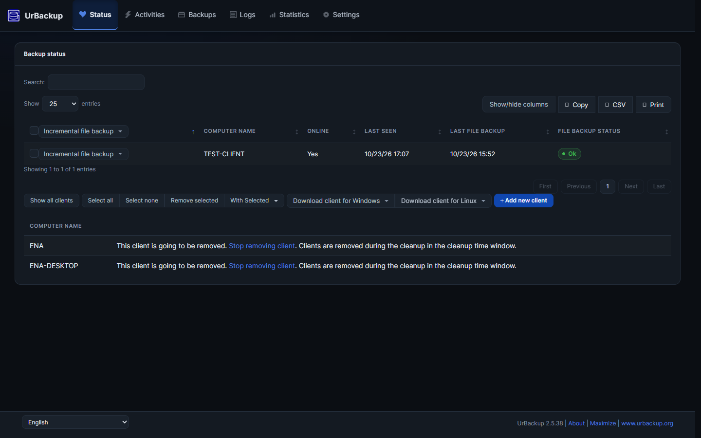
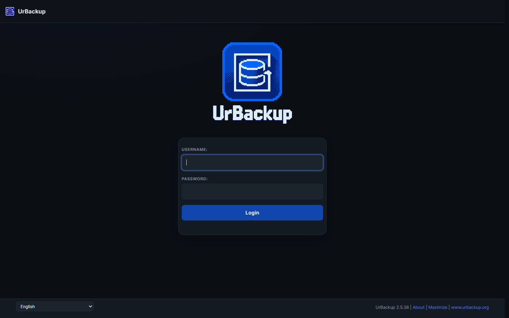
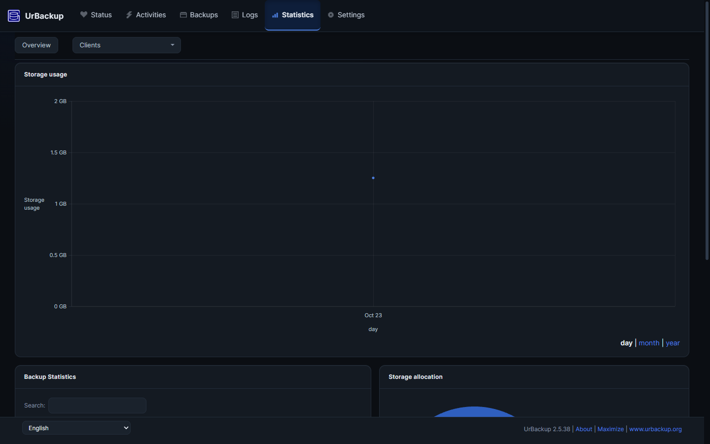
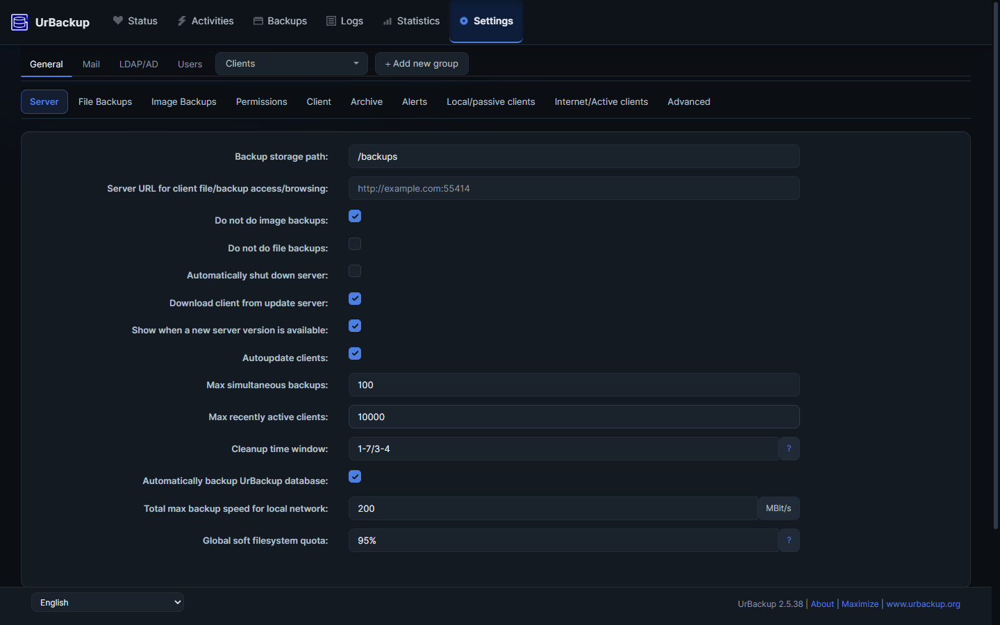

# UrBackup Theme+

An alternative visual style for the [UrBackup](https://www.urbackup.org/) web
interface, with a few small things that make the panel easier to use every day. A
browser extension for Chrome, written in plain CSS and JavaScript. No
build step, no dependencies.

UrBackup is great software and I run it on my own server. I wanted a different
look for it, in a style I like spending hours in. That is all this project is.

Not affiliated with the UrBackup project.

## What it changes

- One dark palette, taken from the UrBackup mark and used on every view: navbar,
  panels, tables, forms, buttons, tabs, dropdowns, alerts, modals.
- Charts painted inside the canvas: quiet grid, readable sizes (`1.25 GB` instead
  of a column of `1GB`), full dates, a compact pie under its legend.
- One page shell, so navbar, content and footer line up at any width, and wide
  tables scroll inside their panel instead of stretching the page.
- A section fades in once its layout has settled, so you never watch a page
  rearrange itself.
- Keyboard and contrast work for free: skip link, focus rings, readable muted
  text, `1` to `6` for the sections, `/` or `F2` for the search field, `Esc` to
  leave it.
- A login page that is one card with the mark above it.

## Optional extras

Each one has a switch in the extension options and applies to open tabs right away.

| Feature | What it does |
| --- | --- |
| Status chips | Table cells with states become readable pills |
| Sticky navigation | Both Settings tab bars stay pinned under the navbar |
| Empty states | Empty tables and panels get a calm placeholder |
| Pixel icons | Pixel art glyphs for the six sections |
| File browser | File type glyphs, aligned sizes, folder actions in the heading |
| Login mark | The UrBackup logo above the login card |
| Hotkeys | The shortcuts above, plus a marker on settings fields with unsaved edits |

## Switching it off

The toolbar button shows up only on UrBackup pages and tells you whether the
server in front of you is on or off. One click flips it. `?ubx=off` in a URL or
`Ctrl+Alt+U` switches the theme off for the session, and the same hotkey brings it
back.

Access is per server. `localhost` and `127.0.0.1` work out of the box, any other
server is added on the options page with one browser prompt.

## Screenshots

| Login | Statistics | Settings |
| --- | --- | --- |
|  |  |  |

## Built with

Plain CSS: components in `src/content/theme.css`, colours and sizes in
`tokens.css`, one file per feature in `src/content/features/`, the worker and the
options page next to them. Every rule is scoped to an attribute the extension sets
on `<html>`, so take that attribute away and the server's own page is back,
untouched.

Most of the code was written with an AI assistant, then measured and corrected by
hand.

## Good to know

- UrBackup 2.4 and 2.5, Chrome or any Chromium 111 or newer. Dark only.
- No analytics, no telemetry, no remote calls. Settings stay in
  `chrome.storage.sync`. See [PRIVACY.md](PRIVACY.md).

## Status

Version 0.2.0, early, unpacked only for now.

## License

MIT, see [LICENSE](LICENSE). UrBackup is licensed separately by its authors. No
UrBackup assets are redistributed here.
